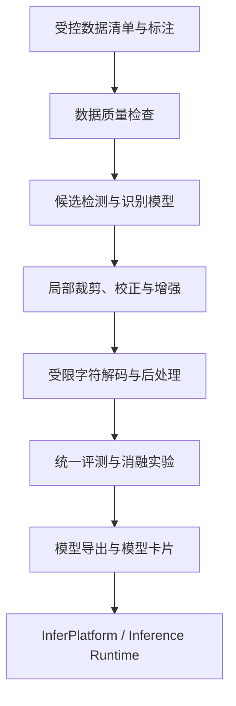

# ModelTrain · 轻眸识刻算法研发与评测中心

> 面向食品包装日期区域定位、受限字符识别、实验评测和模型交付的离线研发仓库

ModelTrain 负责数据适配、模型训练、消融实验、统一评测和标准模型包导出。文档中的模型结构和实验方法均为研发候选或交付约束，具体采用方案以可复现实验结果为准。它不负责客户端 API、在线识别会话、日期语义决策或生产环境的模型调度。

训练所用的数据由 `TrainPlatform` 管理：本仓只读消费其冻结的数据集版本与标注结果，不修改样本、版本与切分。

---

## 一、研发定位与职责边界

### 1. 负责内容

- 日期区域和包装文字的视觉检测与识别算法；
- 点阵、激光和钢印等小目标字符的局部识别；
- 数据读取、标注格式适配和质量检查；
- 训练配置、实验记录和消融评测；
- FP32、FP16 或 INT8 等模型导出方案评估；
- 符合 `MODEL.md` 的模型交付包生成。

### 2. 不负责内容

- 不直接实现 Web、移动端或小程序 API；
- 不维护 `RecognitionSession` 的在线状态；
- 不在模型中实现最终日期期限决策；
- 不直接向客户端提供生产推理接口；
- 不将人工纠偏样本未经审核自动加入训练集；
- 不在公开代码仓库中提交原始图片或其他敏感数据。

模型交付后，由 InferPlatform / Inference Runtime 负责加载、校验和调用；日期语义推导与标示状态决策由 InferPlatform 负责，模型本身只输出约定的机器观察值。

---

## 二、研究主线与处理流程



研究重点包括：

### 1. 日期区域定位

研究适合极小目标和复杂背景的检测结构，关注日期区域面积小、曲面反光、点阵断笔和背景文字干扰等条件下的召回率与误检率。P2 高分辨率检测头等方法属于实验候选，最终以统一评测结果为准。

### 2. 局部图像处理

根据检测框生成局部输入，并评估旋转校正、透视变换、局部对比度增强和形态学处理对不同包装材质的影响。预处理不应掩盖原始图像，也不应替代质量不足时的人工复核。

### 3. 受限字符识别

针对日期、保质期和常见包装标示研究轻量 OCR。候选方法包括 CRNN、SVTR-Tiny 或其他适配目标数据分布的识别网络；受限字典、CTC 解码和规则后处理需要通过实验验证其收益与误纠风险。

### 4. 多分支信息支持

可以分别提取局部打码信息和全局包装说明，再将模型观察值交由 InferPlatform 聚合为结构化证据。ModelTrain 输出观察值，不直接输出最终食品期限结论。

---

## 三、数据与评测规范

### 1. 数据划分

- 训练集、验证集和测试集相互隔离；
- 同一商品、包装批次或高度相似的连续拍摄样本不应跨集合泄漏；
- 测试集不参与超参数调整；
- 按包装材质、打码类型、拍摄角度、光照和清晰度进行分层统计；
- 数据清单和标注检查应可重复执行，原始图片由受控环境提供。

### 2. 检测指标

- mAP@0.5、Precision、Recall；
- 日期区域小目标召回率；
- 漏检率、误检率和不同材质分层结果；
- 单图推理耗时、参数量和模型大小。

### 3. OCR 指标

- 字符错误率（CER）；
- 字段完全匹配率；
- 日期字段解析成功率；
- 非法字符率；
- 误纠正率和低质量输入下的拒识能力。

### 4. 系统关联指标

- 标示状态可推导率；
- 信息缺失和证据冲突的识别率；
- 多图输入下的决策一致性；
- 端侧轻量模型与云端模型的结果差异；
- 置信度不足时转入复核的准确性。

指标数值必须关联数据版本、评测配置和运行环境。README 中的示例数字仅用于说明字段结构，不代表当前项目实测结果。

---

## 四、实验假设与消融设计

下列实验是可复现的研究问题和对照设计，具体结论以统一数据划分和评测结果为准：

| 编号 | 待验证问题 | 对照方向 | 主要指标 |
| :---: | :--- | :--- | :--- |
| H1 | 两阶段定位识别是否优于整图直接 OCR | 整图 OCR / 小目标定位后局部识别 | CER、完全匹配率、单图耗时 |
| H2 | 浅层高分辨率特征是否改善微小日期区域召回 | 标准检测头 / 增加高分辨率检测头 | mAP、Recall、参数量、FLOPs |
| H3 | 几何校正对倾斜打码识别的收益和边界 | 直接裁剪 / 旋转校正 / 透视变换 | NED、识别准确率 |
| H4 | 局部增强在反光和点阵场景中的收益与副作用 | 原始局部图 / CLAHE / 形态学处理 | 识别准确率、粘连误识率 |
| H5 | 受限字符集对错误字符和解码速度的影响 | 通用字典 / 工业受限字典 | CER、非法字符率、耗时 |
| H6 | 加权编辑距离是否降低错误纠正风险 | 标准编辑距离 / 非对称混淆权重 | 完全匹配率、误纠正率 |
| H7 | 全局说明与局部打码的联合观察是否改善证据完整性 | 单分支 / 多分支观察 | 状态可推导率、缺失率 |
| H8 | FP16、INT8 等轻量化方案的精度与速度权衡 | FP32 / FP16 / INT8 | 精度损失、模型大小、端侧耗时 |

任何“提升”或“降低”的结论都应同时报告适用数据范围和可能的副作用，不能仅依据单一指标判断算法方案。

---

## 五、工程结构

```text
ModelTrain/
├── README.md
├── requirements.txt
├── configs/                     # 模型、数据和实验配置
├── datasets/
│   ├── adapters/               # 数据读取和标注格式适配
│   ├── manifests/              # 数据清单与划分配置
│   └── validators/             # 标注和数据质量检查
├── models/
│   ├── detectors/              # 日期区域检测网络
│   ├── recognizers/            # 字符与点阵 OCR 网络
│   └── postprocess/            # 解码、规整和纠错算法
├── experiments/                # 实验配置、运行记录和结果摘要
├── evaluation/                 # 统一评测和指标计算
├── tools/                      # 批量实验和基准测试工具
└── deploy/                     # ONNX 导出、转换和量化脚本
```

工程目录保存代码、配置和可审计的实验元数据，不固定公开原始图片、模型权重缓存或部署环境路径。

---

## 六、模型导出与交付

每次可发布模型都必须生成符合 [`ProjectPRD/contracts/MODEL.md`](https://github.com/QingMouFoodDate/ProjectPRD/blob/main/contracts/MODEL.md) 的自包含交付包，至少包括：

```text
release_bundle/
├── qingmou_det.onnx
├── qingmou_rec.onnx
├── dict.txt
└── metadata.yaml
```

交付前应完成：

- 输入尺寸、通道顺序、归一化和输出张量检查；
- ONNX Runtime 加载和推理 smoke test；
- 字典文件与解码逻辑一致性检查；
- 模型版本、评测配置和运行环境记录；
- 文件完整性和 SHA-256 校验；
- 与基准模型的精度、速度和模型大小对比。

`metadata.yaml` 中的指标必须注明评测数据版本和运行环境，示例字段只用于说明格式，不作为项目性能承诺。

ModelTrain 只交付标准化模型资产和评测信息；InferPlatform 负责模型发布、加载、访问控制和在线推理调用。

---

## 七、技术选型

### 路线 A：PyTorch + ONNX Runtime + OpenCV

- *优势*：便于研究网络结构、训练流程和图像预处理，并可通过 ONNX 对接独立推理运行时；
- *适用场景*：需要灵活开展算法实验，并与 Python 科学计算生态协作的项目。

### 路线 B：PaddlePaddle + PaddleOCR + PaddleDetection

- *优势*：提供较完整的文字检测、识别和中文视觉组件，适合快速验证包装文字处理流程；
- *适用场景*：中文包装文字占比较高，希望复用成熟 OCR 组件的项目。

无论采用哪条研发路线，最终交付都必须满足统一的 ONNX 输入输出、字符字典、元数据、版本和完整性校验契约。

---

## 八、相关文档

- [系统需求](https://github.com/QingMouFoodDate/ProjectPRD/blob/main/REQUIREMENTS.md)
- [系统架构](https://github.com/QingMouFoodDate/ProjectPRD/blob/main/ARCHITECTURE.md)
- [API 接口契约](https://github.com/QingMouFoodDate/ProjectPRD/blob/main/contracts/API.md)
- [数据质量规范](https://github.com/QingMouFoodDate/ProjectPRD/blob/main/standards/DATA_QUALITY.md)
- [模型交付规约](https://github.com/QingMouFoodDate/ProjectPRD/blob/main/contracts/MODEL.md)
