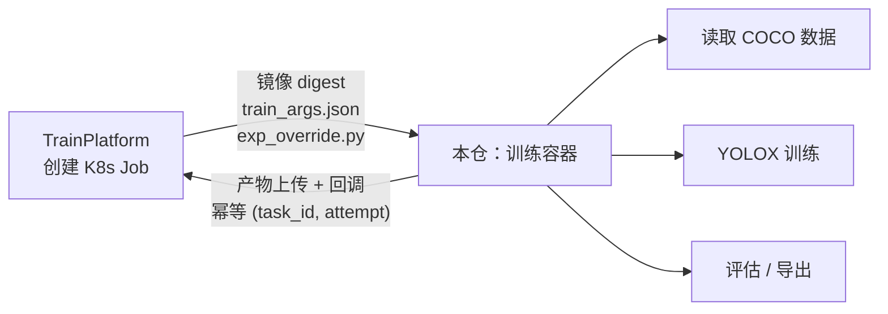

# ModelTrain · 轻眸识刻训练脚本

> 容器里面发生的一切。平台负责把任务送进来，这个仓负责把模型做出来。

---

## 我们在做什么

整个项目想做的事只有一句话：**拍一张食品包装的照片，让机器把生产日期读出来。**

而这一仓，是那个真的把模型训出来的部分。

它不好理解的地方在于——它不是一个能双击打开的软件，也不是一个人会天天浏览的界面。它是一段**跑在容器里的代码**：平台把它唤醒，丢给它一批数据和一组参数，它把模型训出来，把结果传回去，然后消失。

它的使用者其实不是人，是 [TrainPlatform](https://github.com/QingMouFoodDate/TrainPlatform)。

---

## 为什么训练代码要单独一个仓

这件事值得解释一下，因为「不就是几个训练脚本吗，为什么不放在平台仓里」是个很自然的疑问。

答案在于**这两部分的生命周期完全不同**：

平台是长期在线的服务——它一直跑着，数据库一直连着，用户随时可能打开页面。它改动一次，需要测试、需要部署、可能还需要重启。

训练容器是**一次性的**——被创建、跑完、销毁。它的依赖是 CUDA、PyTorch、YOLOX 这些又大又重的东西，一个镜像好几个 G。它的失败是常态（显存不够、数据有问题、节点掉线），需要的是重试和隔离，而不是"别挂"。

把它们放在一个仓里，会带来两个具体的麻烦：改一行平台代码的日志格式，会触发训练镜像重建；换一个 PyTorch 版本，会连带影响平台的 CI。**两者的更新节奏根本不该被绑在一起。**

所以边界划在这里：

- **平台管**：在哪个节点、起哪个镜像、传什么参数、产物收到哪里。
- **本仓管**：容器起来之后的一切。



---

## 一次训练里到底发生了什么

把镜头拉近，一次训练任务的完整过程是这样的：

**第一步，容器被唤醒。** 平台把两样东西挂进来：`train_args.json`（这次任务的只读快照——用哪个数据集版本、输出到哪、是第几次尝试）和 `exp_override.py`（超参数，由平台根据你在界面上填的表单生成）。本仓只负责读，不做二次解析——**参数的唯一真相在平台侧，这里不再做判断**，否则会出现"两边都觉得自己对"的问题。

**第二步，数据准备。** 数据以 COCO 格式物化好（YOLOX 原生就吃这个格式）。如果这次是断点续训，会先找回上次的 `latest_ckpt.pth`，把优化器状态、epoch 计数、学习率调度一起恢复——**从断的地方接着跑，而不是从头再来。**

**第三步，训练。** 调 YOLOX 跑，产物按约定落到 `YOLOX_outputs/<experiment_name>/` 下。文件名是固定的：`latest_ckpt.pth`（每轮更新）、`best_ckpt.pth`（指标最好时）、`train_log.txt`（日志，也是指标曲线的唯一数据源）。

**第四步，评估。** 在验证集上跑 COCOeval，算 mAP、每类 AP、混淆矩阵。这些不是 YOLOX 自己会输出的东西，需要自己算、自己画。

**第五步，出站。** 把产物传到对象存储，然后回调平台。回调带着 `(train_task_id, attempt)` ——**平台侧幂等**，所以这里不需要自己实现去重，重复回调是安全的。

没有第六步。容器销毁。

---

## 功能范围

### 一期做这些

| 区域 | 能力 |
| :--- | :--- |
| **训练** | 训练入口（读 `train_args.json` / `exp_override.py`）；超参 → YOLOX Exp 字段映射；跑训练并落盘 ckpt 与日志 |
| **断点续训** | `attempt > 1` 自动从 `latest_ckpt.pth` 恢复（含 optimizer state / epoch / lr） |
| **产物出站** | 产物上传对象存储 + 回调平台；**幂等键 `(train_task_id, attempt)`** |
| **评估** | COCOeval 指标计算（含 per-class、混淆矩阵、PR 曲线数据）；按切片维度（来源 / 分辨率 / 难例）分组评估 |
| **导出** | ONNX 导出与导出后精度复测 |
| **数据算子** | 视频抽帧（含帧血缘）；去重（精确 / 近重复）；清洗（损坏 / 模糊 / 无目标 / 尺寸异常）；分组切分；数据增强配置 |
| **环境** | 训练镜像 Dockerfile（CUDA → PyTorch → YOLOX → 代码）与构建脚本 |

### 一期不做这些

- ❌ 任务调度、节点管理、排队 —— 那是平台的事，这里只被调度
- ❌ 数据存储与版本管理 —— 这里只读，不改
- ❌ 任何面向人的界面

---

## 技术栈，以及两个必须守住的坑

| 层 | 选型 | 为什么 |
| :--- | :--- | :--- |
| 语言 | **Python 3.11+** | 生态在这里，没有第二选择 |
| 训练框架 | **YOLOX（Apache-2.0）** | 见下面的坑二 |
| 深度学习 | **PyTorch + CUDA** | 版本必须锁定，见坑一 |
| 数据格式 | **COCO** | YOLOX 原生支持，也便于和外部数据集互通 |
| 指标 | pycocotools | 目标检测的事实标准 |
| 导出 | ONNX（`opset=11`） | 端侧要用，见 [MobileClient](https://github.com/QingMouFoodDate/MobileClient) |

### 坑一：PyTorch 版本必须锁定，禁止用 latest

YOLOX 的源码里用的是 `torch.cuda.amp.GradScaler`，这条路径在新版 PyTorch 里已经被弃用，而 YOLOX 上游最后一次更新停在 2023 年 2 月——**它不会再跟着 PyTorch 走了**。

这不是"以后可能出问题"，是"换个版本立刻出问题"。所以镜像里必须把 torch 版本钉死，而且整个环境的可复现性以 **image digest** 为准，不看 tag。tag 会变，digest 不会。

### 坑二：训练框架必须是 Apache-2.0 系，不能用 Ultralytics

YOLO 系列里最有名的是 Ultralytics 的实现，但它用的是 **AGPL-3.0**——这个许可证会**传染到它训练出来的模型权重**，而且官方明确说明：内部私有、未开源的项目同样需要购买商业授权。

这意味着如果用了它，我们训出来的每一个模型都带着授权瑕疵。所以一开始就选了 **YOLOX**，同样是 Apache-2.0 的 YOLO 系列实现。将来如果要换成 MMDetection 或 RT-DETR，也必须满足同一条约束。

**这不是技术偏好，是合规底线。**

---

## 规划目录结构

```text
ModelTrain/
├── entrypoints/
│   └── train.py             # 训练入口：读参数 → 构建 Exp → 跑训练 → 上传产物 → 回调
├── qmtrain/
│   ├── config/              # train_args.json / exp_override.py 的解析与校验
│   ├── exp/                 # YOLOX Exp 字段映射与默认值
│   ├── artifacts/           # 产物发现、上传、回调（幂等）
│   ├── resume/              # 断点续训逻辑
│   ├── eval/                # COCOeval 指标、切片评估、报告生成
│   ├── export/              # ONNX / TRT / OpenVINO / NCNN 导出与精度复测
│   └── ops/                 # 数据算子：抽帧、去重、清洗、切分、增强
├── docker/
│   ├── Dockerfile.train     # 训练镜像
│   └── Dockerfile.ops       # 数据算子镜像
├── tests/
└── README.md
```

---

## 与平台的契约

平台通过**三样东西**驱动本仓，其余全部由本仓自治。

### 1. 入参

| 文件 | 内容 |
| :--- | :--- |
| `train_args.json` | 只读快照：`train_task_id`、`attempt`、数据集物化路径、输出目录、`params_hash` |
| `exp_override.py` | 白名单字段生成，**由平台生成**，本仓只读取执行，不做二次解析 |

### 2. 产物约定（文件名固定，平台按名回收）

| 文件 | 说明 |
| :--- | :--- |
| `YOLOX_outputs/<experiment_name>/latest_ckpt.pth` | 每 epoch 覆盖 |
| `YOLOX_outputs/<experiment_name>/best_ckpt.pth` | AP 提升时 |
| `YOLOX_outputs/<experiment_name>/epoch_<n>_ckpt.pth` | 由 `save_history_ckpt` 控制 |
| `YOLOX_outputs/<experiment_name>/train_log.txt` | 指标曲线的唯一数据源 |

> 评估产物（PR 曲线、混淆矩阵、`eval_<epoch>.json`）**不是 YOLOX 原生产物**，
> 由本仓的评估模块自行绘制并输出。

### 3. 回调

上传完成后回调平台，携带 `(train_task_id, attempt)`。
**平台侧幂等**：重复回调只落一条模型版本记录——本仓不要自己实现去重。

---

## 快速开始

```bash
# 依赖：Docker + NVIDIA Container Toolkit、Python 3.11+

# 构建训练镜像
docker build -f docker/Dockerfile.train -t qingmou-train:dev .

# 本地试跑（模拟平台传入的参数）
docker run --gpus all -v "$PWD/fixtures:/work" qingmou-train:dev \
  python entrypoints/train.py --args /work/train_args.json
```

---

## 相关文档

仓库里只放代码，产品设计与全部决策依据在 [ProjectPRD](https://github.com/QingMouFoodDate/ProjectPRD)：

| 文档 | 内容 |
| :--- | :--- |
| [PLAN.md](https://github.com/QingMouFoodDate/ProjectPRD/blob/main/PLAN.md) | 产品形态 + Issue 清单 |
| [REPOS.md](https://github.com/QingMouFoodDate/ProjectPRD/blob/main/REPOS.md) | 仓库地图与跨仓契约 |
| [P0082](https://github.com/QingMouFoodDate/ProjectPRD/blob/main/PRD/05_训练平台/P0082_训练任务提交与调度.md) | 任务调度与执行器 |
| [P0083](https://github.com/QingMouFoodDate/ProjectPRD/blob/main/PRD/05_训练平台/P0083_超参数与训练模板.md) | 超参面与快照 |
| [P0112](https://github.com/QingMouFoodDate/ProjectPRD/blob/main/PRD/07_部署推理/P0112_端侧导出.md) | 端侧导出与精度复测 |

---

## License

内部项目，未经许可不得外传。
