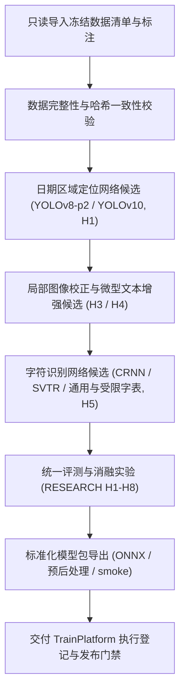

# ModelTrain · 轻眸识刻算法研发与评测中心

> 面向食品包装小目标检测、微型字符识别、消融评测与标准化模型交付的离线研发仓库
>
> **工程状态**：M0 待实现 · 当前仅有 README，无训练、评测或导出代码

ModelTrain 负责视觉感知算法研发，围绕**“非受控实拍包装日期的证据驱动自适应识读与选择性复核”**核心研究主线，涵盖日期区域定位模型、微型字符 OCR 网络的训练调优、基线评测、消融实验与标准模型包（ModelBundle）导出；在线推理与业务编排由 InferPlatform 提供支持。

---

## 工程状态与边界说明

| 维度         | 说明                                                                                                                                                                                                                                                                                                                                 |
| :----------- | :----------------------------------------------------------------------------------------------------------------------------------------------------------------------------------------------------------------------------------------------------------------------------------------------------------------------------------- |
| **当前阶段** | M0 待实现，先建立可复现的单机训练与评测基线                                                                                                                                                                                                                                                                                          |
| **实现范围** | M0 聚焦单图检测、局部 OCR 与候选包导出；P2、超分辨率、受限字表等按基线对照选用，不作为 C0 首轮硬性选型                                                                                                                                                                                                                               |
| **契约基准** | 数据输入与模型产物以 [contracts/DATA.md](https://github.com/QingMouFoodDate/ProjectPRD/blob/main/contracts/DATA.md)、[contracts/TRAINING.md](https://github.com/QingMouFoodDate/ProjectPRD/blob/main/contracts/TRAINING.md) 与 [contracts/MODEL.md](https://github.com/QingMouFoodDate/ProjectPRD/blob/main/contracts/MODEL.md) 为准 |

项目保留 7 个项目仓库及组织 `.github` 仓，共 8 仓；MobileClient、WxClient 暂缓实现。下文为设计规划，所列模块与目录尚未创建。

---

## 一、研发定位与职责边界

### 1. 核心负责内容

- **小目标定位算法**：针对复杂背景建立检测基线，对照 P2 高分辨率特征层等候选，测量微小日期区域召回与计算开销；
- **微型字符识别**：针对点阵喷码、激光打标与钢印字符，对照局部几何校正、超分辨率增强与字符解码候选；
- **只读数据适配**：消费 TrainPlatform 冻结的受控数据集版本，执行版本与哈希一致性核验；
- **统一实验与消融**：严密对照基线配置，执行 [算法实验](https://github.com/QingMouFoodDate/ProjectPRD/blob/main/算法实验.md) 规划的消融验证并记录指标；
- **标准交付包导出**：生成 ONNX 候选模型包，成套交付预后处理配置、字典与 smoke 验证用例。

### 2. 研发协作与系统边界

- **只读消费原则**：严格只读消费已冻结快照数据，不擅自增删清洗样本或篡改标注，严防数据泄漏；
- **在线服务解耦**：不直接向客户端提供业务接口或参与会话编排，在线模型加载由 InferPlatform 内部 Runtime 承接；
- **业务决策隔离**：模型输出张量，Runtime 解码并还原原图坐标后构建 `Observation`；本仓不生成业务 `Evidence / Decision`；
- **发布授权归口**：导出候选包须保留实际自测结果，登记、校验与发布授权由 TrainPlatform 管理，导出不代表获准上线。

---

## 二、研究主线与算法处理流程



研究编号沿用 [算法实验](https://github.com/QingMouFoodDate/ProjectPRD/blob/main/算法实验.md)：H1 P2、H2 低置信增强重试、H3 主轴旋转、H4 CLAHE 与闭运算、H5 受限字表、H6 非对称加权编辑距离、H7 全局/局部证据分支、H8 FP16/INT8 对照。超分辨率等补充方向另行评审；H1 至 H8 作为基线与支持消融编号，保留无增益、退化与失败结果。H7 在关联标注具备后推进，H8 端侧量化暂缓。

本轮主线候选是“非受控实拍包装日期的证据驱动自适应识读与选择性复核”：先用真值框和真值转录诊断定位、OCR 与语义瓶颈，再校准完整日期及类型结果的可靠性；随后比较裁剪、分辨率、方向校正或替代 OCR 的追加收益与处理成本，决定何时值得重试或补拍。原始 OCR 保留，规则和语言模型不补造不可见文字。成熟流程组合、固定置信阈值或增加模型数量不单独作为创新结论。

---

## 三、算法执行入口与契约映射

根据上位 [contracts/TRAINING.md](https://github.com/QingMouFoodDate/ProjectPRD/blob/main/contracts/TRAINING.md) 约定，本仓规划提供以下四类离线执行入口：

| 执行入口     | 输入契约                                          | 输出产物与记录                                              |
| :----------- | :------------------------------------------------ | :---------------------------------------------------------- |
| **训练入口** | 冻结数据集版本、超参配置、基础权重与依赖          | 训练状态记录、损失曲线、检查点文件（Checkpoint）及日志摘要  |
| **评测入口** | 固定评测集版本、模型引用与分层指标设定            | 标准评测记录（EvalRecord），含分层场景下的各项精度指标      |
| **消融入口** | 上位消融实验编号（H1~H8）、基线配置与受控对照参数 | 固定随机种子的对照数据、波动、失败项与实际结果              |
| **导出入口** | 已评测权重、实际字典、图像标准化与后处理配置      | 候选模型包（ModelBundle）、文件 SHA-256 清单及 smoke 验证集 |

待实现的单机 CLI 或受控 worker 承接上述四入口；任务模式只有 `TRAIN / EVALUATE / EXPORT`，消融是任务与配置的组合，不新增 mode。每轮绑定作业与 attempt、冻结数据及配置哈希、代码、环境、父包和隔离输出；输入不一致时拒绝执行，失败保留原因并隔离产物，事件交 TrainPlatform 核验。

---

## 四、 冻结数据遵循与评测基准

基准数据集已完成全量肉眼审判与质量网关检验，数据由 TrainPlatform 统筹冻结；采集、许可、标注与审核进度以 [DATA 第二节](https://github.com/QingMouFoodDate/ProjectPRD/blob/main/contracts/DATA.md#二离线-sampleasset) 为准，训练与评测只读取审核后冻结的版本。

### 1. 最新基准数据集分布 · 1617 张主基准库

| 资产层级 / 集合 | 受控切分标识     | 物理原图量 |    占比    | 评测与治理说明                           |
| :-------------- | :--------------- | :--------: | :--------: | :--------------------------------------- |
| **数据来源**    | 网络图片         |    1207    |   79.3%    | 采集来源计数，使用前核验许可、标注与审核 |
|                 | 线下实拍         |    316     |   20.7%    | 采集来源计数，保留拍摄及同源分组记录     |
| **合计**        | **当前采集样本** |  **1523**  | **100.0%** | **采集数量不代表训练资格或冻结完成**     |

标示类型、打码工艺与难度分布待核验。

### 2. 数据切分、防泄漏与工程预处理规范

1. **8:1:1 科学分层防泄漏切分**：
   - 训练 80% (1293 张)、验证 10% (162 张)、测试 10% (162 张) 为基准冻结划分，由 TrainPlatform 批准并固化清单；
   - 严格依据包装材质（纸盒、软塑、易拉罐、玻璃瓶、真空袋）、打码工艺（点阵喷码、激光打码、热转印、钢印压痕）与难度分层，确保验证与测试集具有同等代表性。
2. **防泄漏切分（`group_key`）**：
   - 分组与 `train / val / test` 由 TrainPlatform 固定，本仓只读；同一实物、采集会话、连拍、近重复及派生图严格按 `group_key` 隔离，严禁同源样本跨集合泄漏；
   - 先切分再裁剪、缓存或增强；派生资产记录父样本 ID、源哈希、参数与 bbox 变换，继承原组和 split，写入隔离输出，不覆写原图、标注或清单，不增加独立样本计数；
   - 测试集绝对不参与阈值、字表、纠错权重、模型选优、难例回流或量化校准；INT8 使用登记的训练侧校准子集。
3. **ModelTrain 动态数据增强候选**：
   - 几何微扰：小幅旋转、透视与多尺度缩放，±15°、0.8~1.2 可作对照参数示例，检查截断与插值损失；
   - 色彩光照：HSV 饱和度/亮度扰动、对比度拉伸，±20% 为参数示例，检查弱笔画与点阵可见性；
   - 鲁棒退化：比较 Cutout、高斯模糊与点阵椒盐噪声；不可见文字不沿用完整 OCR 真值，须排除该监督或按审核后的可见性规则处理。
4. **建议本地离线执行的预处理工程实践**：
   - **CLAHE 局部直方图均衡化**：对照原切片与增强通道，记录弱钢印、反光场景的识别变化及噪声放大；
   - **超大分辨率多尺度 ROI 预切片缓存**：宽或高超过 2000px、Padding 20% 可作候选配置；核验框映射、裁剪遗漏，并实测显存、存储与 I/O 开销；
   - **字符朝向正规化**：比较原视角与 90°/180°/270° 旋转，同步转换 bbox 并保留正逆映射，检查训练与推理处理是否一致；
   - **难负样本离线挖掘池**：从合规训练侧图像裁剪条形码、SC 编号、营养表等干扰区域，人工确认用途并继承父样本、来源与分组。
5. **多维度分层报告与基线规范**：
   - 依 [算法实验](https://github.com/QingMouFoodDate/ProjectPRD/blob/main/算法实验.md) 按包装载体、打码工艺与难度报告指标、样本数及失败项；模型前向、Runtime 与端到端时延分别计时，注明环境、尺寸与批次；
   - 验证与测试采用评测前固定的处理流程，不使用随机训练增强；记录实际命令、种子与波动，未测量结果不填作实测。

评测同时报告完整字段、日期类型与关联正确性、风险—覆盖率、误纠正和 p95 处理成本；在相同覆盖率或处理预算下比较简单阈值、规则过滤、多 OCR 选择等强基线。阈值和动作策略只用训练及验证数据确定，未见商品与设备单独测试，不把某一分布上的结果外推为无条件可靠性保证。

---

## 五、标准模型交付包结构

导出的候选模型包必须满足 [contracts/MODEL.md](https://github.com/QingMouFoodDate/ProjectPRD/blob/main/contracts/MODEL.md) 的统一要求：

| 组成部分         | 交付资产与文件                         | 规约要求                                                |
| :--------------- | :------------------------------------- | :------------------------------------------------------ |
| **核心权重资产** | `qingmou_det.onnx`、`qingmou_rec.onnx` | ONNX 模型权重，按目标平台验证兼容性                     |
| **词典与映射**   | `dict.txt`、`labels.json`              | 字符编码字典与小目标检测类别定义                        |
| **处理管线配置** | `preprocess.yaml`、`postprocess.yaml`  | 归一化参数、目标尺寸、置信度阈值与解码逻辑              |
| **元数据与血缘** | `metadata.yaml`、`manifest.json`       | 实际张量 Profile、兼容环境、实验血缘与文件 SHA-256 清单 |
| **可复现验证**   | `evaluation.json`、`smoke/` 验证集     | 分层评测指标记录与自测输入输出测试向量                  |

交付前验证真实张量、字典、预后处理与 smoke 的一致性；内容或配置变化另建版本。候选包交 TrainPlatform 登记、校验与发布，发布不等于 active；InferPlatform 核验外部授权后控制激活与回滚，细节见 MODEL。

---

## 六、提议工程目录结构

M0 以单机复现为目标，原图、缓存、检查点与模型制品通过配置引用受控位置，不进入普通代码历史。

```text
ModelTrain/                     # 离线算法研发与模型交付仓库
├── README.md                   # 算法架构、输入输出与交付规约
├── requirements.txt            # Python 与 PyTorch 核心依赖
├── configs/                    # 训练、评测与消融实验配置文件
├── datasets/                   # 冻结数据的只读适配与校验模块
│   ├── adapters/               # 标注格式转换与读取适配
│   ├── manifests/              # 冻结数据集索引与清单管理
│   └── validators/             # 数据哈希与防泄漏分组检验
├── models/                     # 视觉网络架构定义与实现
│   ├── detectors/              # 日期区域小目标定位网络
│   ├── recognizers/            # 微型字符与点阵 OCR 网络
│   └── postprocess/            # 几何校正与字符解码后处理
├── experiments/                # 实验运行元数据与超参记录
├── evaluation/                 # 统一评测与分层指标统计工具
├── tools/                      # 训练、评测与消融单机 CLI 脚本
└── deploy/                     # ONNX 导出、模型转换与 smoke 检查
```

---

## 七、相关文档

- [需求规格](https://github.com/QingMouFoodDate/ProjectPRD/blob/main/需求规格.md)
- [系统架构](https://github.com/QingMouFoodDate/ProjectPRD/blob/main/系统架构.md)
- [开发路线](https://github.com/QingMouFoodDate/ProjectPRD/blob/main/开发路线.md)
- [算法实验](https://github.com/QingMouFoodDate/ProjectPRD/blob/main/算法实验.md)
- [数据模型](https://github.com/QingMouFoodDate/ProjectPRD/blob/main/contracts/DATA.md)
- [训练调度规范](https://github.com/QingMouFoodDate/ProjectPRD/blob/main/contracts/TRAINING.md)
- [模型交付规约](https://github.com/QingMouFoodDate/ProjectPRD/blob/main/contracts/MODEL.md)
- [数据质量规范](https://github.com/QingMouFoodDate/ProjectPRD/blob/main/standards/数据质量规范.md)
- [工程协作指南](https://github.com/QingMouFoodDate/ProjectPRD/blob/main/standards/工程协作指南.md)
- [研究现状](https://github.com/QingMouFoodDate/ProjectPRD/blob/main/references/研究现状.md)
