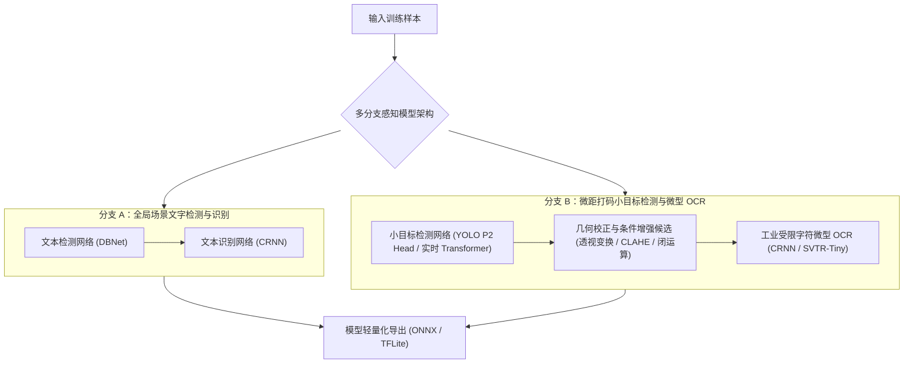

# ModelTrain · 轻眸识刻算法研发与评测中心

> **组织归属**：`QingMouFoodDate` GitHub 组织  
> **仓库性质**：**算法核心研发仓库**，专注于小目标打码检测、微距工业 OCR、数据增强与消融评测

---

## 一、 核心定位与技术攻关主线

立足大创立项申报书确立的研究主线，本仓库专注于计算机视觉与深度学习算法的组网、离线训练、消融实验与轻量化模型导出，部署于 GPU 算力工作站：



### 1. 核心技术主线
- **分支 A（全局场景文字提取）**：构建基于 DBNet + CRNN 的全局文字检测与识别流程，负责提取包装印刷说明中的保质期时长（如“保质期 12 个月”）、储存温区及位置指向词；
- **分支 B（微距打码小目标检测与识别）**：引入浅层高分辨率特征检测头（P2 Head），攻坚占全图面积不足 1% 的微小打码区域定位；配合几何校正与受限字典微型 OCR 提取点阵、激光与钢印字符；
- **非对称加权纠错算法**：基于工业喷码断针混淆特征构建加权编辑距离动态规划模型，对低置信度字符进行语义纠偏；
- **模型轻量化与导出规约**：将训练模型导出为标准静态 Profile ONNX 模型，并探索 INT8 离线量化（PTQ）对推理精度的影响。

### 2. 职责解耦
- 本仓库专注于算法代码、网络定义、训练超参、消融实验脚本与模型卡片（Model Card）维护；
- 在线推理服务与业务规则决策由 `TrainPlatform` 的运行时模块统一承接。

---

## 二、 8 项中性消融科研假设

将各项算法设计转化为具有统计可复现性的消融实验：

| 假设编号 | 科学假设命题 (Hypothesis) | 对照组设计 (Baseline vs Proposed) | 检验评价指标 |
| :---: | :--- | :--- | :--- |
| **H1** | 评估两阶段定位识别相比于单阶段整图直接端到端 OCR 在工业打码召回率与推理延迟上的差异 | **基线**：整图端到端直接文本检测识别<br/>**实验**：小目标打码检测 ➔ 局部微距识别 | 字符错误率 (CER)、完全匹配率 (Exact Match)、单图耗时 (ms) |
| **H2** | 评估在特征金字塔中引入浅层高分辨率检测头（P2 Head，步长=4）对微小面积打码召回率的提升幅度与计算开销 | **基线**：标准多尺度检测头<br/>**实验**：增加 P2 浅层高分辨率检测头 | mAP@0.5、小目标召回率 (Recall)、参数量与 FLOPs |
| **H3** | 评估两阶段几何校正（最小外接旋转矩形校正 vs 四点单应性透视变换）对倾斜角度打码识别精度的实际改善 | **基线**：水平外接矩形直接裁剪<br/>**实验 A**：主轴旋转角度校正<br/>**实验 B**：四点单应性透视变换 | 字符级归一化编辑距离 (NED)、端到端文本识别准确率 |
| **H4** | 分别评估局部 CLAHE 与形态学闭运算在强反光金属表面与点阵喷码上的有效性边界与副作用 | **基线**：原始局部切片输入 OCR<br/>**实验 A**：仅叠加局部 CLAHE<br/>**实验 B**：仅叠加微型结构元形态学闭运算 | 字符识别准确率、粘连误识率（按易拉罐/塑料/纸盒分层统计） |
| **H5** | 检验将候选字符空间限制为工业预设字符集（数字、基础符号、少量限定汉字与缩写）对 CER 和非法字符率的影响 | **基线**：通用中英文大字表<br/>**实验**：工业受限字表 (<100 字) | 字符错误率 (CER)、非法字符产生率、解码耗时 |
| **H6** | 检验基于喷码断针物理特征设计的非对称加权编辑距离混淆矩阵在提升纠错精确率的同时是否会引发过度纠错 | **基线**：无权重标准编辑距离正则纠错<br/>**实验**：引入非对称混淆权重动态规划纠错 | 纠错后完全匹配率、误纠正率 (False Correction Rate) |
| **H7** | 检验在输入信息量一致的前提下，多分支并行感知（全局说明提取 + 局部微距打码）相比单分支的标示推算完成率 | **基线**：仅依赖局部微距打码单分支输入<br/>**实验**：全局说明与局部微距双分支并行推理 | 标示状态可推算成功率、信息缺失状态占比 |
| **H8** | 检验 INT8 训练后量化（PTQ）与 FP16 精度转换在不同移动端推理运行时下的精度损失与加速比 | **基线**：FP32 全精度基准模型<br/>**实验 A**：FP16 转换模型<br/>**实验 B**：INT8 PTQ 离线量化模型 | 相对精度损失百分点、模型存储尺寸 (MB)、移动端 CPU 单帧推理耗时 |

---

## 三、 推荐算法实验架构

目录结构遵循实验配置与网络代码解耦规范，除根目录外，仅展示文件夹层级：

```text
ModelTrain/
├── README.md
├── requirements.txt
├── .gitignore
├── configs/
├── datasets/
├── models/
│   ├── detectors/
│   ├── recognizers/
│   └── postprocess/
├── tools/
└── deploy/
```

---

## 四、 数据集挂载与算法交付规约

1. **集中数据集挂载**：数据集统一对接 TrainPlatform 部署服务器的集中样本存储服务，代码仓库中严禁提交高容量图像文件；
2. **规范交付产物**：模型训练收敛并通过基准评测后，严格遵循 [`ProjectPRD/contracts/模型交付规约.md`](https://github.com/QingMouFoodDate/ProjectPRD/blob/main/contracts/模型交付规约.md) 导出包含检测 ONNX、识别 ONNX、`dict.txt` 与评估卡片 `metadata.yaml` 的交付产物包。

---

## 五、 技术选型参考

- **路线 A（推荐 · 工业算法标准生态）**：`PyTorch + ONNX Runtime + OpenCV + Albumentations`
  - *优势*：主流首选，模型组网灵活，算法验证迁移成本低，向标准 ONNX 导出链条完善。
- **路线 B（备选 · 工业落地套件）**：`PaddlePaddle + PaddleOCR + PaddleDetection`
  - *优势*：内置成熟的工业文字检测识别轻量模型与中文先验权重。
