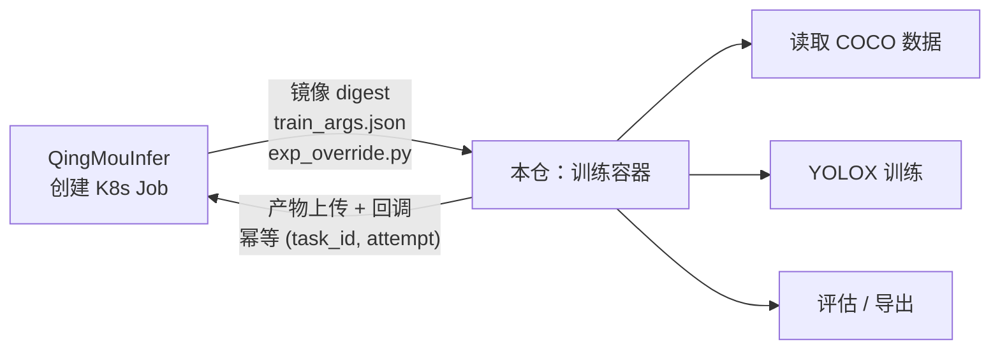

# QingMouTrain · 轻眸识刻训练脚本

> 轻眸识刻的**执行面**：跑在训练容器里的一切——训练、评估、导出、数据算子。

本仓是 [轻眸识刻](https://github.com/QingMouFoodDate/QingMouPRD) 的**容器内代码**，
由 [QingMouInfer](https://github.com/QingMouFoodDate/QingMouInfer) 以 K8s Job 的方式拉起。
平台只负责"在哪个节点起哪个镜像、传什么参数、产物收回哪里"，
**容器里怎么跑**全部由本仓负责。

---

## 一、在整体架构中的位置



**归属判据**：跑在**训练/处理容器内**的逻辑属于本仓。

---

## 二、功能范围

### 做（一期）

| 区域 | 能力 |
| :--- | :--- |
| **训练** | 训练入口（读 `train_args.json` / `exp_override.py`）；超参 → YOLOX Exp 字段映射；跑训练并落盘 ckpt 与日志 |
| **断点续训** | `attempt > 1` 自动从 `latest_ckpt.pth` 恢复（含 optimizer state / epoch / lr） |
| **产物出站** | 产物上传对象存储 + 回调平台；**幂等键 `(train_task_id, attempt)`** |
| **评估** | COCOeval 指标计算（含 per-class、混淆矩阵、PR 曲线数据）；按切片维度（来源 / 分辨率 / 难例）分组评估 |
| **导出** | ONNX 导出与导出后精度复测 |
| **数据算子** | 视频抽帧（含帧血缘）；去重（精确 / 近重复）；清洗（损坏 / 模糊 / 无目标 / 尺寸异常）；分组切分；数据增强配置 |
| **环境** | 训练镜像 Dockerfile（CUDA → PyTorch → YOLOX → 代码）与构建脚本 |

### 不做

- ❌ 任务调度、节点管理、排队（属 QingMouInfer）
- ❌ 数据存储与版本管理（属 QingMouInfer）
- ❌ 面向用户的界面
- ❌ 任何 AGPL 许可的框架

---

## 三、技术栈

| 层 | 选型 |
| :--- | :--- |
| 语言 | **Python 3.11+** |
| 训练框架 | **YOLOX（Apache-2.0）** |
| 深度学习 | **PyTorch + CUDA**（⚠️ **版本必须锁定**，见下） |
| 数据格式 | **COCO**（YOLOX 原生） |
| 图像/视频 | OpenCV、ffmpeg、Pillow |
| 指标 | pycocotools |
| 导出 | ONNX（`opset=11`）、可选 TensorRT / OpenVINO / NCNN / TFLite |
| 镜像 | 多阶段 Dockerfile；以 **image digest** 交付 |

### ⚠️ 两条必须遵守的硬约束

1. **PyTorch 版本必须锁定，禁止 `latest`。**
   YOLOX 源码使用 `torch.cuda.amp.GradScaler`（新版 PyTorch 已弃用该路径），
   且上游最后更新停在 2023-02。镜像里固定 torch 版本是"可复现"的前提。
2. **训练框架必须是 Apache-2.0 系。**
   Ultralytics YOLO 为 AGPL-3.0 **且传染至其训练出的权重**，内部私有使用亦需商业授权，
   因此本项目不使用。若将来引入其它框架（MMDetection / RT-DETR），必须同样满足此约束。

---

## 四、规划目录结构

```text
QingMouTrain/
├── entrypoints/
│   └── train.py             # 训练入口：读参数 → 构建 Exp → 跑训练 → 上传产物 → 回调
├── qmtrain/
│   ├── config/              # train_args.json / exp_override.py 的解析与校验
│   ├── exp/                 # YOLOX Exp 字段映射与默认值
│   ├── artifacts/           # 产物发现、上传、回调（幂等）
│   ├── resume/              # 断点续训逻辑
│   ├── eval/                # COCOeval 指标、切片评估、报告生成
│   ├── export/              # ONNX / TRT / OpenVINO / NCNN 导出与精度复测
│   └── ops/                 # 数据算子：抽帧、去重、清洗、切分、增强
├── docker/
│   ├── Dockerfile.train     # 训练镜像
│   └── Dockerfile.ops       # 数据算子镜像
├── tests/
└── README.md
```

---

## 五、与平台的契约（关键）

平台通过**三样东西**驱动本仓，其余全部由本仓自治：

### 1. 入参

| 文件 | 内容 |
| :--- | :--- |
| `train_args.json` | 只读快照：`train_task_id`、`attempt`、数据集物化路径、输出目录、`params_hash` |
| `exp_override.py` | 白名单字段生成，**由平台生成**，本仓只读取执行，不做二次解析 |

### 2. 产物约定（文件名固定，平台按名回收）

| 文件 | 说明 |
| :--- | :--- |
| `YOLOX_outputs/<experiment_name>/latest_ckpt.pth` | 每 epoch 覆盖 |
| `YOLOX_outputs/<experiment_name>/best_ckpt.pth` | AP 提升时 |
| `YOLOX_outputs/<experiment_name>/epoch_<n>_ckpt.pth` | 由 `save_history_ckpt` 控制 |
| `YOLOX_outputs/<experiment_name>/train_log.txt` | 指标曲线的唯一数据源 |

> 评估产物（PR 曲线、混淆矩阵、`eval_<epoch>.json`）**不是 YOLOX 原生产物**，
> 由本仓的评估模块自行绘制并输出。

### 3. 回调

上传完成后回调平台，携带 `(train_task_id, attempt)`。
**平台侧幂等**：重复回调只落一条模型版本记录——本仓不要自己实现去重。

---

## 六、快速开始

```bash
# 依赖：Docker + NVIDIA Container Toolkit、Python 3.11+

# 构建训练镜像
docker build -f docker/Dockerfile.train -t qingmou-train:dev .

# 本地试跑（模拟平台传入的参数）
docker run --gpus all -v "$PWD/fixtures:/work" qingmou-train:dev \
  python entrypoints/train.py --args /work/train_args.json
```

---

## 七、相关文档

| 文档 | 内容 |
| :--- | :--- |
| [PLAN.md](https://github.com/QingMouFoodDate/QingMouPRD/blob/main/PLAN.md) | 产品形态 + Issue 清单 |
| [REPOS.md](https://github.com/QingMouFoodDate/QingMouPRD/blob/main/REPOS.md) | 仓库地图与跨仓契约 |
| [P0082](https://github.com/QingMouFoodDate/QingMouPRD/blob/main/PRD/05_训练平台/P0082_训练任务提交与调度.md) | 任务调度与执行器 |
| [P0083](https://github.com/QingMouFoodDate/QingMouPRD/blob/main/PRD/05_训练平台/P0083_超参数与训练模板.md) | 超参面与快照 |
| [P0112](https://github.com/QingMouFoodDate/QingMouPRD/blob/main/PRD/07_部署推理/P0112_端侧导出.md) | 端侧导出与精度复测 |

---

## License

内部项目，未经许可不得外传。
