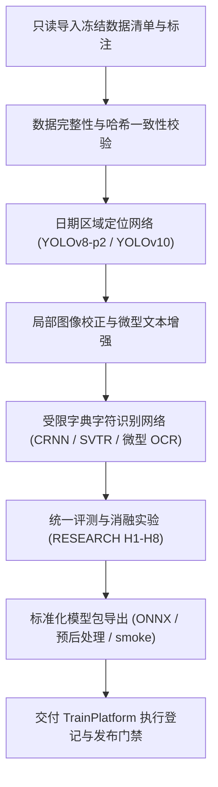

# ModelTrain · 轻眸识刻算法研发与评测中心

> 面向食品包装小目标检测、微型字符识别、消融评测与标准化模型交付的离线研发仓库
>
> **工程状态**：算法设计就绪 · M0 单图闭环推进中 · 只读消费冻结数据集 · 模型成果由 TrainPlatform 登记治理

ModelTrain 负责视觉感知算法攻坚，涵盖日期区域定位模型、微型字符 OCR 网络的训练调优、基线评测、消融实验与标准模型包（ModelBundle）导出；在线推理与业务编排由 InferPlatform 提供支持。

---

## 工程状态与边界说明

| 维度 | 说明 |
| :--- | :--- |
| **当前阶段** | 处于架构规范与 M0 核心原型攻坚阶段，支持单机 CLI 独立开展算法实验 |
| **实现范围** | M0 阶段聚焦单图主链路所需的基础检测与局部识别算法闭环，多分支复杂结构随后续阶段递进开展 |
| **契约基准** | 数据输入与模型产物严格受限于上位 [contracts/DATA.md](../ProjectPRD/contracts/DATA.md)、[contracts/TRAINING.md](../ProjectPRD/contracts/TRAINING.md) 与 [contracts/MODEL.md](../ProjectPRD/contracts/MODEL.md) |

---

## 一、研发定位与职责边界

### 1. 核心负责内容

- **小目标定位算法**：针对复杂背景，研发小目标定位网络（如适配 P2 高分辨率特征层），提升微小日期区域召回率；
- **微型字符识别**：针对点阵喷码、激光打标与钢印字符，研发局部几何校正、超分辨率增强与受限字符解码算法；
- **只读数据适配**：消费 TrainPlatform 冻结的受控数据集版本，执行版本与哈希一致性核验；
- **统一实验与消融**：严密对照基线配置，执行 [算法实验](../ProjectPRD/算法实验.md) 规划的消融验证并记录指标；
- **标准交付包导出**：生成符合全域规约的 ONNX 格式模型包，包含预后处理配置、字典与 smoke 验证用例。

### 2. 研发协作与系统边界

- **只读消费原则**：严格只读消费已冻结快照数据，不擅自增删清洗样本或篡改标注，严防数据泄漏；
- **在线服务解耦**：不直接向客户端提供业务接口，不参与会话编排，推理结果由 InferPlatform 的 Runtime 加载生成；
- **业务决策隔离**：算法模型仅输出边界框、类别置信度与识别文本（Observation），不直接推导保质期业务结论；
- **发布授权归口**：导出产物代表本地技术自测通过，模型登记、正式校验与发布门禁统一由 TrainPlatform 管理。

---

## 二、研究主线与算法处理流程



---

## 三、算法执行入口与契约映射

根据上位 [contracts/TRAINING.md](../ProjectPRD/contracts/TRAINING.md) 约定，本仓主要提供四大核心离线执行入口：

| 执行入口 | 输入契约 | 输出产物与记录 |
| :--- | :--- | :--- |
| **训练入口** | 冻结数据集版本、超参配置、基础权重与依赖 | 训练状态记录、损失曲线、检查点文件（Checkpoint）及日志摘要 |
| **评测入口** | 固定评测集版本、模型引用与分层指标设定 | 标准评测记录（EvalRecord），含分层场景下的各项精度指标 |
| **消融入口** | 上位消融实验编号（H1~H8）、基线配置与受控对照参数 | 可复现随机种子的实验对比数据与边际增益报告 |
| **导出入口** | 通过评测的权重、受限字典、图像标准化与后处理逻辑 | 候选模型包（ModelBundle）、文件 SHA-256 清单及 smoke 验证集 |

各入口支持以独立 CLI 工具运行，异常时产生具备明确错误原因的结构化日志，杜绝生成破损或半成品的输出。

---

## 四、冻结数据遵循与评测基准

1. **防泄漏与分组隔离**：遵循商品聚类（`group_key`）数据集切分，训练集、验证集与测试集物理绝缘；测试集严禁参与训练或超参选优。
2. **多维度分层报告**：算法评测按包装材质（塑料膜、金属罐、纸盒、玻璃瓶）、喷码工艺（点阵墨水、激光烧蚀、钢印压痕）及环境条件（反光、曲面畸变）分层呈现指标。
3. **性能基线规范**：延迟与资源占用数据注明测试硬件、输入分辨率、批处理尺寸与预热轮次，杜绝无依据的性能宣称。

---

## 五、标准模型交付包结构

导出的候选模型包必须满足 [contracts/MODEL.md](../ProjectPRD/contracts/MODEL.md) 的统一要求：


| 组成部分 | 交付资产与文件 | 规约要求 |
| :--- | :--- | :--- |
| **核心权重资产** | `qingmou_det.onnx`、`qingmou_rec.onnx` | ONNX 格式标准模型权重，支持跨平台轻量推理 |
| **词典与映射** | `dict.txt`、`labels.json` | 字符编码字典与小目标检测类别定义 |
| **处理管线配置** | `preprocess.yaml`、`postprocess.yaml` | 归一化参数、目标尺寸、置信度阈值与解码逻辑 |
| **元数据与血缘** | `metadata.yaml`、`manifest.json` | 依赖环境版本、实验编号与全文件 SHA-256 指纹清单 |
| **可复现验证** | `evaluation.json`、`smoke/` 验证集 | 分层评测指标记录与自测输入输出测试向量 |

导出的模型包交付 TrainPlatform 执行发布门禁，经批准后由 InferPlatform 在线加载生效。

---

## 六、提议工程目录结构

```text
ModelTrain/                     # 离线算法研发与模型交付仓库
├── README.md                   # 算法架构、输入输出与交付规约
├── requirements.txt            # Python 与 PyTorch 核心依赖
├── configs/                    # 训练、评测与消融实验配置文件
├── datasets/                   # 冻结数据的只读适配与校验模块
│   ├── adapters/               # 标注格式转换与读取适配
│   ├── manifests/              # 冻结数据集索引与清单管理
│   └── validators/             # 数据哈希与防泄漏分组检验
├── models/                     # 视觉网络架构定义与实现
│   ├── detectors/              # 日期区域小目标定位网络
│   ├── recognizers/            # 微型字符与点阵 OCR 网络
│   └── postprocess/            # 几何校正与字符解码后处理
├── experiments/                # 实验运行元数据与超参记录
├── evaluation/                 # 统一评测与分层指标统计工具
├── tools/                      # 训练、评测与消融单机 CLI 脚本
└── deploy/                     # ONNX 导出、模型转换与 smoke 检查
```

---

## 七、权威依据与参考文档

| 规范维度 | 事实源契约 | 核心约束说明 |
| :--- | :--- | :--- |
| **系统设计与规划** | [需求规格](../ProjectPRD/需求规格.md) · [系统架构](../ProjectPRD/系统架构.md) · [开发路线](../ProjectPRD/开发路线.md) | 确立系统功能边界、8 仓架构分层与 M0 迭代里程碑 |
| **科研假设与实验** | [算法实验](../ProjectPRD/算法实验.md) | 规范 H1~H8 算法假设、消融对照组与分层评测指标 |
| **跨仓技术契约** | [contracts/DATA.md](../ProjectPRD/contracts/DATA.md) · [contracts/TRAINING.md](../ProjectPRD/contracts/TRAINING.md) · [contracts/MODEL.md](../ProjectPRD/contracts/MODEL.md) | 离线执行入口、数据接口规范与标准化模型交付要求 |
| **质量与工程规范** | [数据质量规范](../ProjectPRD/standards/数据质量规范.md) · [工程协作指南](../ProjectPRD/standards/工程协作指南.md) | 样本准入红线、生活容差与代码提交规约 |


